# OpenAsync — complete graph atlas and analysis

**Run 183246 · current source `abff493d9` · V2 pool · .NET 10.0.13 · Ubuntu 22.04.5 · 16 processors**

This report shows **all six scenarios for every metric family in the recovered analysis**, plus iteration variability, admission/query details and the offered-load phases. It is not a historical-baseline comparison and is not restricted to the most dramatic results.

**Reading the graphs:** blue = Open; orange = OpenAsync. Unless otherwise stated, each point is the median of nine per-invocation aggregates from **three independent processes**, with two warmups per process excluded. Whiskers are observed min–max, **not confidence intervals**. A median of invocation p95s is not a pooled-operation p95. Lines only join tested levels 1, 8, 32 and 64; intervening values were not measured.

Sampled timings and Diagnostic measurements are separate. Linear panels have independently labeled scales; the probe graph has a shared **logarithmic** scale. Blank panels are missing observations—not zero. Per-panel tables below also show available observation counts at 64 workers.

| Scenario | Workload |
|---|---|
| E1 | Warm pooled reuse |
| E2 | Pool contention |
| E3 | Nonpooled opens |
| E4 | Cold pooled ramp |
| E5 | Matched async query |
| E6 | Overload / recovery |

## Contents

- 1. Throughput
- 2. Open completion latency
- 3. Time to return a pending task
- 4. Fraction completed when OpenAsync returns
- 5. Open-to-close lifecycle latency
- 6. Peak outstanding Open calls
- 7. Allocation cost
- 8. CPU cost
- 9. Peak busy-worker proxy
- 10. Peak queued ThreadPool work
- 11. Unrelated-work responsiveness
- 12. Blocking-open evidence in contained stacks
- 13. SQL scheduler runnable-queue observations
- 14–15. Iteration-position throughput and process-to-process variability
- 16–17. Worker admission, cold-ramp common-epoch completion and matched query
- 18–21. Overload acceptance/rejection, backlog, end-to-end tails and late recovery
- Coverage and data-quality tables; complete phase accounting; provenance and limits

## 1. Throughput

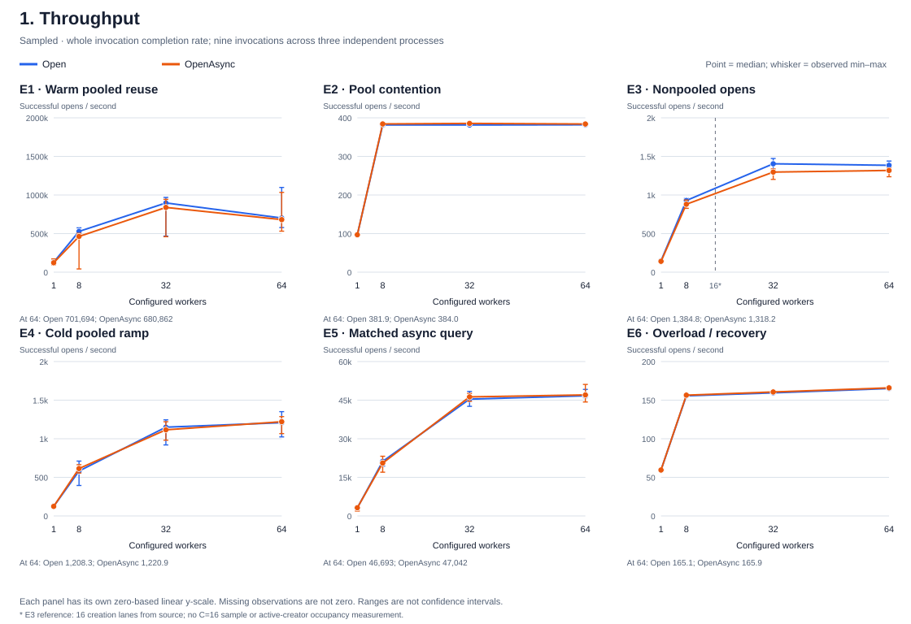

Sampled · whole invocation completion rate; nine invocations across three independent processes.

| Panel | At 64: Open / OpenAsync | Interpretation |
|---|---|---|
| E1 | 701,694 (n=9) / 680,862 (n=9) | Warm fast-path throughput rises then levels off. Large overlapping ranges mean small async/sync differences are not established regressions. |
| E2 | 381.9 (n=9) / 384.0 (n=9) | Four connections and matched 10 ms holds cap service near 400/s. Async changes waiting cost, not that capacity limit. |
| E3 | 1,384.8 (n=9) / 1,318.2 (n=9) | **Async plateaus at 32–64 callers.** The 16 creation chains can queue additional requests; server and CPU limits can also contribute. |
| E4 | 1,208.3 (n=9) / 1,220.9 (n=9) | Similar sync/async cohort throughput. This does not show the scheduling delay that appears in admission and probe graphs. |
| E5 | 46,693 (n=9) / 47,042 (n=9) | The identical async query dominates. Both opening APIs reach similar whole-lifecycle throughput. |
| E6 | 165.1 (n=9) / 165.9 (n=9) | This is completed accepted work divided by whole invocation time—not the 800/s overload offer rate. Rejected offers are excluded from success throughput. |

## 2. Open completion latency

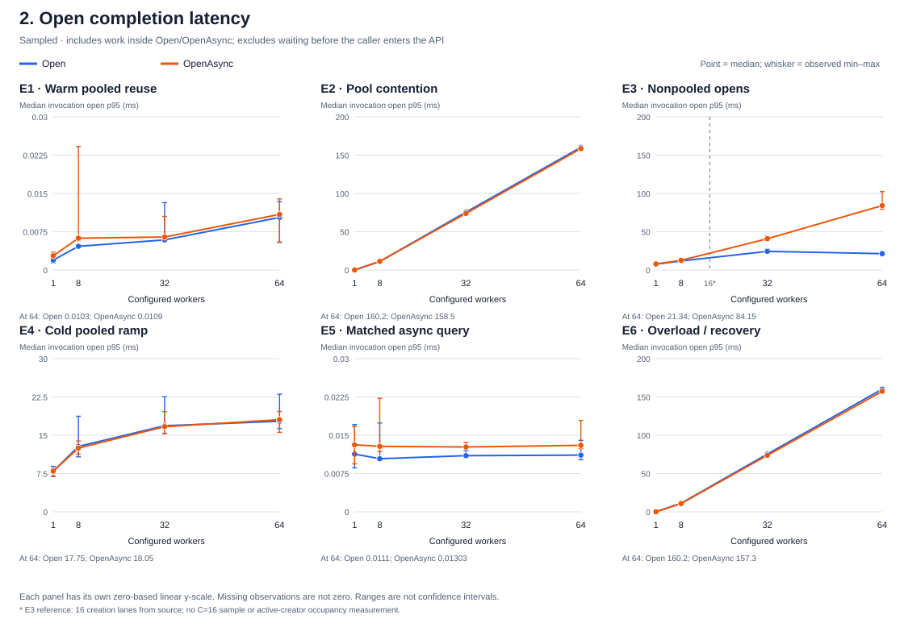

Sampled · includes work inside Open/OpenAsync; excludes waiting before the caller enters the API.

| Panel | At 64: Open / OpenAsync | Interpretation |
|---|---|---|
| E1 | 0.0103 (n=9) / 0.0109 (n=9) | Warm reuse is a microsecond-scale fast path. It does not exercise a pending async wait. |
| E2 | 160.2 (n=9) / 158.5 (n=9) | Open latency grows with queue depth even though task return is fast. Pool capacity, not API shape, limits service. |
| E3 | 21.34 (n=9) / **84.15 (n=9)** | **Async p95 rises from 12.64 ms at 8 callers to 84.15 ms at 64, while throughput plateaus.** Internal creation-chain waiting is included. |
| E4 | 17.75 (n=9) / 18.05 (n=9) | API-only latency is around 18 ms at 64 callers; common-epoch completion is around 50 ms. The difference in definitions matters. |
| E5 | 0.0111 (n=9) / 0.01303 (n=9) | Open p95 stays tiny relative to query p95. It is not the main contributor to the measured lifecycle. |
| E6 | 160.2 (n=9) / 157.3 (n=9) | More active workers can be waiting for four connections. This excludes time before entering Open; offered-to-close latency captures more of the load queue. |

## 3. Time to return a pending task

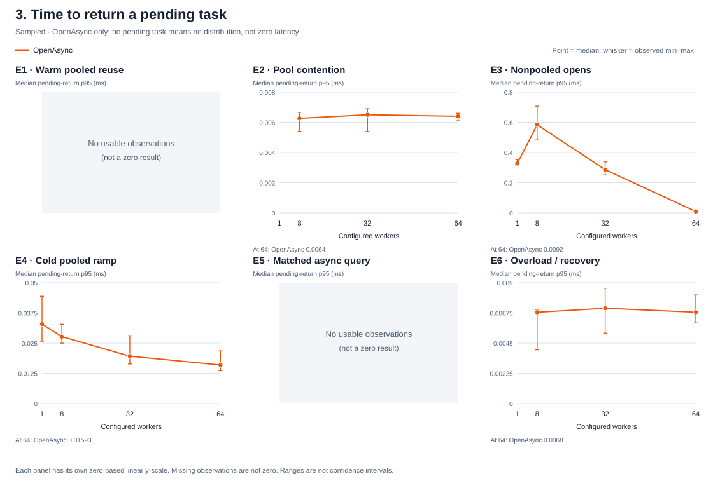

Sampled · OpenAsync only; no pending task means no distribution, not zero latency.

| Panel | At 64: Open / OpenAsync | Interpretation |
|---|---|---|
| E1 | N/A / N/A | No pending opens were observed: warm OpenAsync completed synchronously. There is no pending-return percentile to plot. |
| E2 | N/A / 0.0064 (n=9) | Contended callers receive a task quickly, then wait much longer for a connection. Prompt task return is useful but not sufficient. |
| E3 | N/A / 0.0092 (n=9) | Fast return at high concurrency coexists with creation-chain queueing and 84 ms open p95. Return and completion are distinct. |
| E4 | N/A / 0.01593 (n=9) | Return p95 is about 0.016 ms at 64, but admission and unrelated-work delay remain tens of milliseconds. |
| E5 | N/A / N/A | All measured opens completed at return. The following async query is separate from the open task. |
| E6 | N/A / 0.0068 (n=9) | Pending return remains fast during contention; it does not include time waiting in the offered-load channel before calling the API. |

## 4. Fraction completed when OpenAsync returns

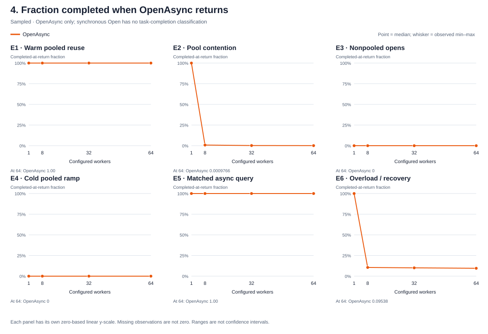

Sampled · OpenAsync only; synchronous Open has no task-completion classification.

| Panel | At 64: Open / OpenAsync | Interpretation |
|---|---|---|
| E1 | N/A / 1.00 (n=9) | 100% immediate completion throughout this warm-reuse matrix. This is expected and is not a violation of async best practices. |
| E2 | N/A / 0.0009766 (n=9) | Near-zero immediate completion under contention: most calls genuinely wait for pool availability. |
| E3 | N/A / 0 (n=9) | Physical connection establishment is pending. This does not reveal whether the implementation uses async I/O or offloaded blocking. |
| E4 | N/A / 0 (n=9) | Cold creation is pending, yet shared workers can still block below the public API. |
| E5 | N/A / 1.00 (n=9) | 100% immediate open completion; query execution supplies the asynchronous work in this workload. |
| E6 | N/A / 0.09538 (n=9) | Some opens complete immediately, others wait. The whole-invocation mix includes baseline, overload and recovery phases. |

## 5. Open-to-close lifecycle latency

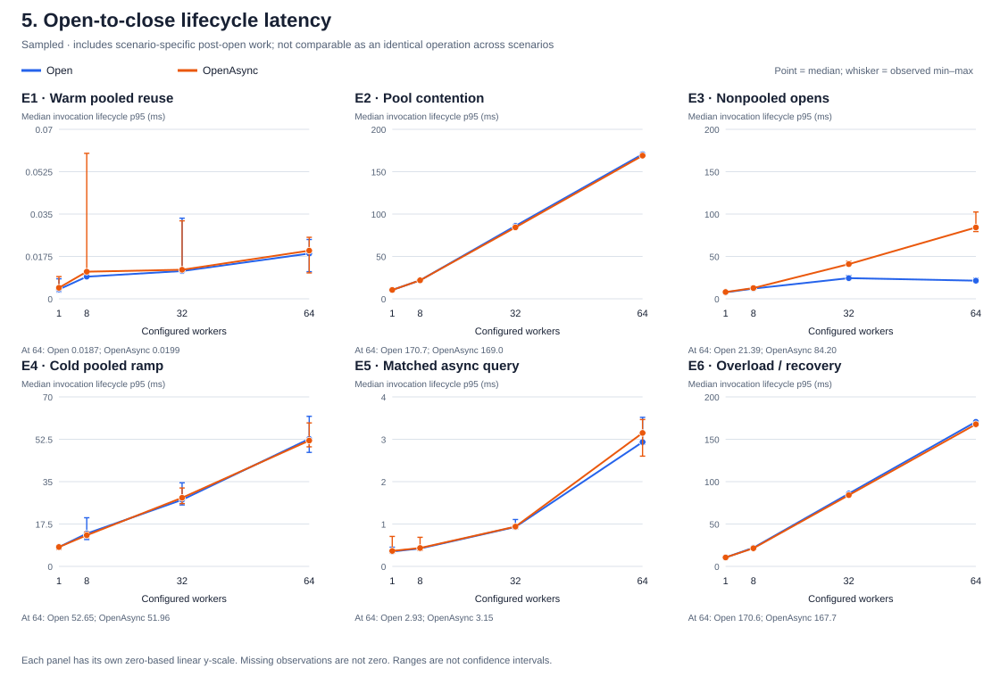

Sampled · includes scenario-specific post-open work; not comparable as an identical operation across scenarios.

| Panel | At 64: Open / OpenAsync | Interpretation |
|---|---|---|
| E1 | 0.0187 (n=9) / 0.0199 (n=9) | Mostly warm checkout and disposal. Differences are tiny and affected by instrumentation. |
| E2 | 170.7 (n=9) / 169.0 (n=9) | Includes the matched 10 ms async hold as well as pool acquisition and disposal. |
| E3 | 21.39 (n=9) / **84.20 (n=9)** | Includes physical open and disposal. **Internal admission to a creation chain is already inside the open interval.** |
| E4 | 52.65 (n=9) / 51.96 (n=9) | Includes the retention barrier: early successful connections remain open until the whole cohort has opened. |
| E5 | 2.93 (n=9) / 3.15 (n=9) | Includes the same async SELECT 1 and disposal for either opening API. |
| E6 | 170.6 (n=9) / 167.7 (n=9) | Includes the 10 ms hold after entering Open, but not the earlier offered-load queue; use offered-to-close graphs for that. |

## 6. Peak outstanding Open calls

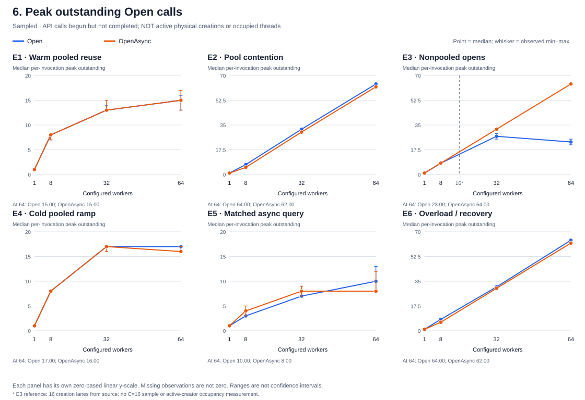

Sampled · API calls begun but not completed; NOT active physical creations or occupied threads.

| Panel | At 64: Open / OpenAsync | Interpretation |
|---|---|---|
| E1 | 15.00 (n=9) / 15.00 (n=9) | Fast completion keeps observed overlap below configured workers. Configured concurrency is not achieved instantaneous concurrency. |
| E2 | 64.00 (n=9) / 62.00 (n=9) | Calls can be outstanding while asynchronously waiting for the pool. These counts are not busy-worker counts. |
| E3 | 23.00 (n=9) / 64.00 (n=9) | Async reaches 64 outstanding calls, but at most 16 creation chains can execute physical opens. Queued calls remain outstanding. |
| E4 | 17.00 (n=9) / 16.00 (n=9) | **Only about 16–17 opens overlap at 64 configured workers, consistent with delayed cohort admission.** |
| E5 | 10.00 (n=9) / 8.00 (n=9) | The query keeps workers occupied outside the open interval, so open overlap can be much lower than worker count. |
| E6 | 64.00 (n=9) / 62.00 (n=9) | Only calls that have reached Open are counted. Offers still in the load channel are not included. |

## 7. Allocation cost

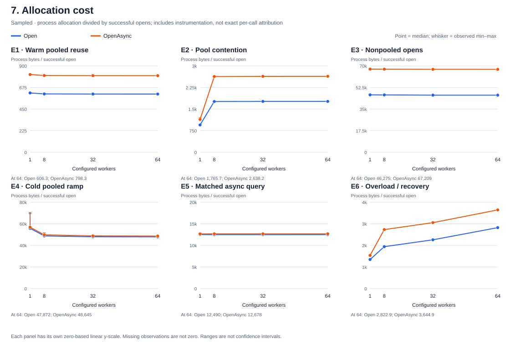

Sampled · process allocation divided by successful opens; includes instrumentation, not exact per-call attribution.

| Panel | At 64: Open / OpenAsync | Interpretation |
|---|---|---|
| E1 | 606.3 (n=9) / 798.3 (n=9) | **Async adds roughly 192 bytes per successful warm open at 64 callers.** |
| E2 | 1,765.7 (n=9) / 2,638.2 (n=9) | **Contended async acquisition has additional task/continuation state** despite lower worker occupancy. |
| E3 | 46,275 (n=9) / **67,209 (n=9)** | **Async uses about 67.2 kB versus 46.3 kB sync at 64 callers: roughly 45% more**, alongside its responsiveness benefit. |
| E4 | 47,872 (n=9) / 48,645 (n=9) | Cold-ramp allocation is similar, with a smaller async increment than repeated nonpooled opens. |
| E5 | 12,490 (n=9) / 12,678 (n=9) | Query/lifecycle work dominates roughly 12.5–12.7 kB per successful open; opening-API overhead is a small share. |
| E6 | 2,822.9 (n=9) / **3,644.9 (n=9)** | Normalization includes load-generator/queue overhead, including rejected offers. Do not interpret this as bytes allocated solely by Open. |

## 8. CPU cost

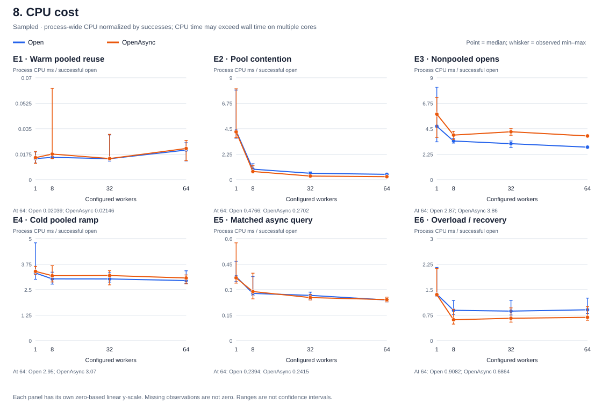

Sampled · process-wide CPU normalized by successes; CPU time may exceed wall time on multiple cores.

| Panel | At 64: Open / OpenAsync | Interpretation |
|---|---|---|
| E1 | 0.02039 (n=9) / 0.02146 (n=9) | Very short operations make process-wide/instrumentation overhead important; small differences need longer targeted evidence. |
| E2 | 0.4766 (n=9) / 0.2702 (n=9) | Async uses less normalized CPU at 64 callers (~0.270 vs ~0.477 ms), despite almost identical throughput. |
| E3 | 2.87 (n=9) / **3.86 (n=9)** | **Async uses more normalized CPU (~3.86 vs ~2.87 ms at 64)**, so protecting unrelated work is not free. |
| E4 | 2.95 (n=9) / 3.07 (n=9) | Costs are similar across APIs. This metric alone cannot attribute the shared-worker scheduling delay. |
| E5 | 0.2394 (n=9) / 0.2415 (n=9) | Query processing and lifecycle work dominate; API differences are small and ranges overlap. |
| E6 | 0.9082 (n=9) / 0.6864 (n=9) | CPU includes independent offered-load generation and rejected work. Interpret alongside acceptance/rejection counts. |

## 9. Peak busy-worker proxy

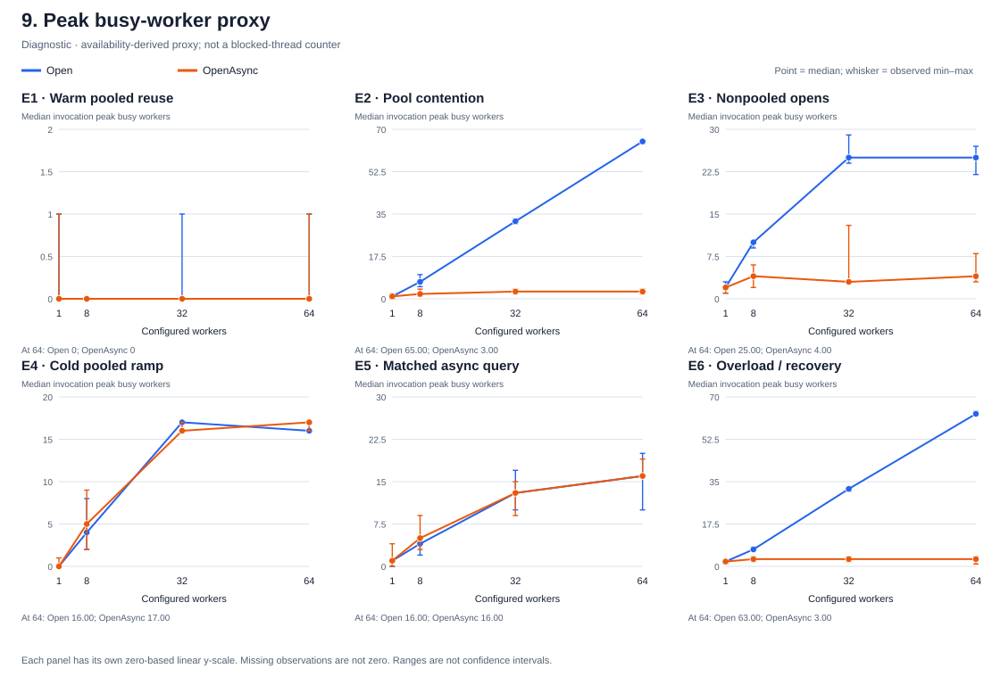

Diagnostic · availability-derived proxy; not a blocked-thread counter.

| Panel | At 64: Open / OpenAsync | Interpretation |
|---|---|---|
| E1 | 0 (n=9) / 0 (n=9) | Short windows can miss activity entirely. Zero sampled busy workers does not mean the workload ran without workers. |
| E2 | **65.00 (n=9)** / 3.00 (n=9) | Strong separation: at 64 callers the proxy is 65 sync versus 3 async. The warm-pool await releases workers. |
| E3 | **25.00 (n=9)** / 4.00 (n=9) | Async offloads synchronous creation to LongRunning threads, so the ordinary ThreadPool stays much less occupied. |
| E4 | 16.00 (n=9) / 17.00 (n=9) | **Both APIs occupy ordinary workers during cold pooled creation.** Similar counts align with similar probe delays. |
| E5 | 16.00 (n=9) / 16.00 (n=9) | Both variants run the same async query; concurrency and query continuation work influence worker usage. |
| E6 | **63.00 (n=9)** / 3.00 (n=9) | Async keeps far fewer workers occupied while waiting for pool capacity. Overload itself still exists. |

## 10. Peak queued ThreadPool work

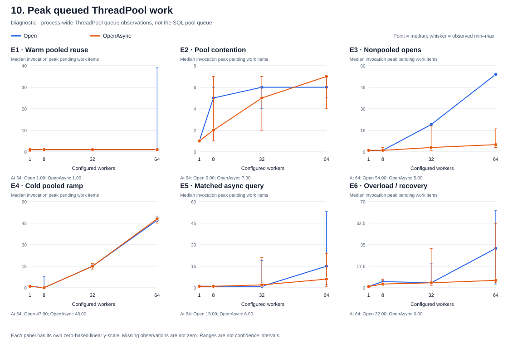

Diagnostic · process-wide ThreadPool queue observations, not the SQL pool queue.

| Panel | At 64: Open / OpenAsync | Interpretation |
|---|---|---|
| E1 | 1.00 (n=9) / 1.00 (n=9) | Low counts in tiny windows do not prove an absence of queueing between polls. |
| E2 | 6.00 (n=9) / 7.00 (n=9) | Pool waiting and ThreadPool waiting are different. An async pool waiter need not remain a queued ThreadPool work item. |
| E3 | **54.00 (n=9)** / 5.00 (n=9) | At 64 callers, **sync shows a median peak queue of 54 versus 5 async**, consistent with ordinary-worker pressure. |
| E4 | **47.00 (n=9) / 48.00 (n=9)** | **Both APIs accumulate queued work during cold ramp.** This is the important contrast with nonpooled async. |
| E5 | 15.00 (n=9) / 6.00 (n=9) | Async query continuations and the workload itself contribute; counts are not attributable solely to opening. |
| E6 | **32.00 (n=9)** / 6.00 (n=9) | The independent load channel is not this queue. Keep ThreadPool queue and offered-load backlog separate. |

## 11. Unrelated-work responsiveness

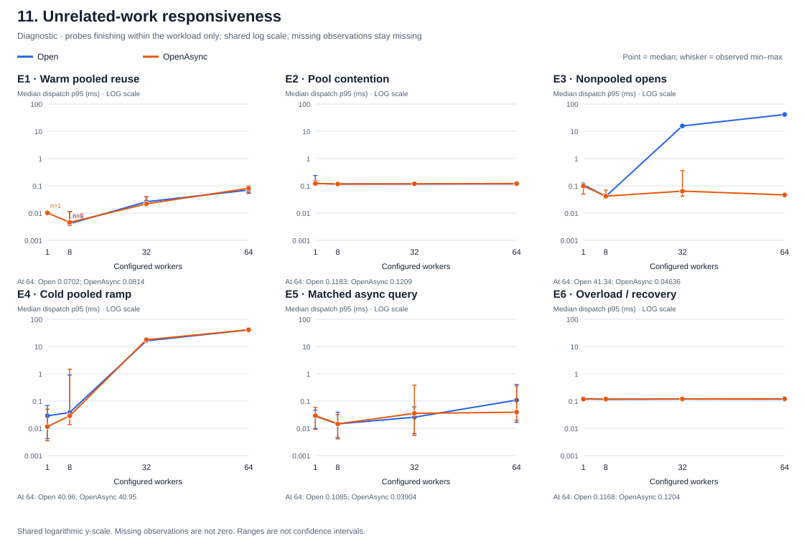

Diagnostic · probes finishing within the workload only; shared log scale; missing observations stay missing.

| Panel | At 64: Open / OpenAsync | Interpretation |
|---|---|---|
| E1 | 0.0702 (n=9) / 0.0814 (n=9) | Few observations fit these short invocations; some cells have fewer than nine usable invocation distributions. |
| E2 | 0.1183 (n=9) / 0.1209 (n=9) | Both stay near 0.12 ms despite different worker occupancy. The sync pool can have enough workers to keep these probes responsive. |
| E3 | **41.34 (n=9)** / 0.04636 (n=9) | At 64 callers, **41.34 ms sync versus 0.046 ms async** is the clearest responsiveness separation. |
| E4 | **40.96 (n=9) / 40.95 (n=9)** | **Both approach 41 ms at 64 callers. Fast async task return did not isolate the cold creation work from ordinary workers.** |
| E5 | 0.1085 (n=9) / 0.03904 (n=9) | Probe delays remain sub-millisecond in these observations; no large scheduling collapse is apparent. |
| E6 | 0.1168 (n=9) / 0.1204 (n=9) | Both remain around 0.12 ms despite overload. This does not imply accepted requests have low end-to-end latency. |

## 12. Blocking-open evidence in contained stacks

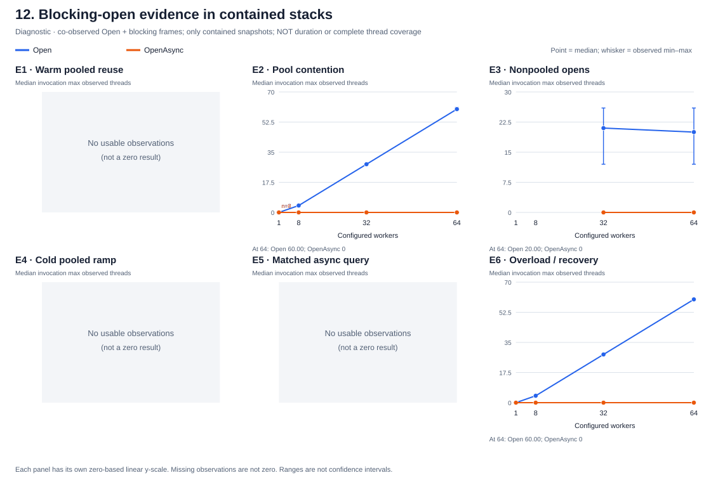

Diagnostic · co-observed Open + blocking frames; only contained snapshots; NOT duration or complete thread coverage.

| Panel | At 64: Open / OpenAsync | Interpretation |
|---|---|---|
| E1 | N/A / N/A | No contained captures: no blocked-thread conclusion is available. |
| E2 | **60.00 (n=9)** / 0 (n=9) | **Sync captures expose many blocking-open threads**; async captures observe none. This corroborates the worker-occupancy difference. |
| E3 | **20.00 (n=9)** / 0 (n=9) | Only the longer 32/64-worker cases have contained captures. Zero async observations do not prove that dedicated-thread creation is nonblocking. |
| E4 | N/A / N/A | No contained captures: the cold-ramp mechanism is supported by source, not directly attributed by these stacks. |
| E5 | N/A / N/A | No contained captures: absence of evidence is not evidence of no blocking. |
| E6 | **60.00 (n=9)** / 0 (n=9) | Contained captures show **sync blocking-open threads**, consistent with pool contention; async's observed count is zero. |

## 13. SQL scheduler runnable-queue observations

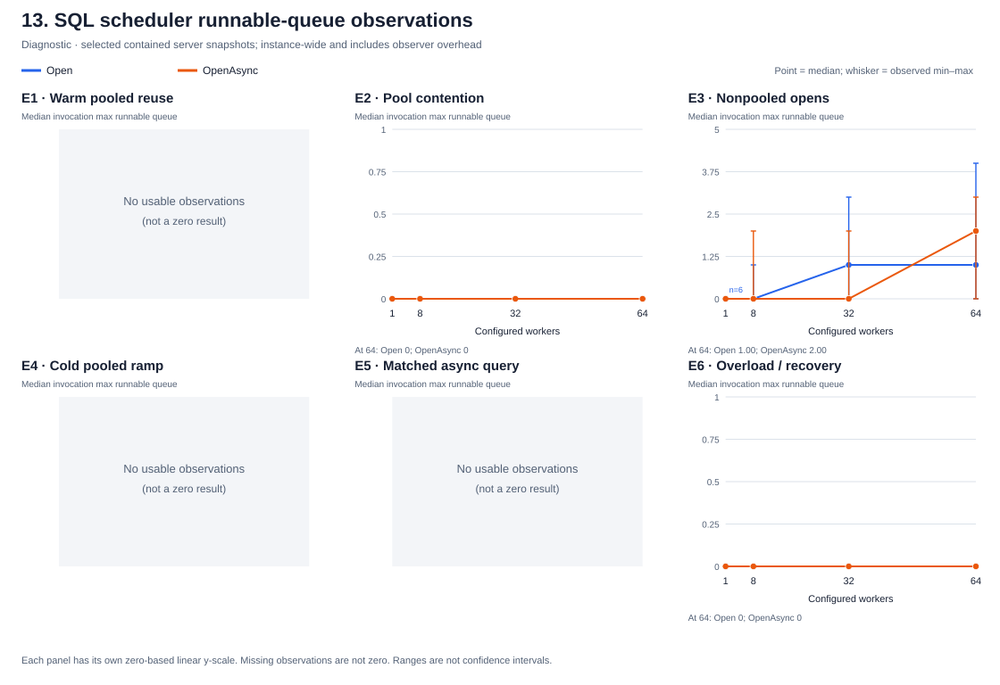

Diagnostic · selected contained server snapshots; instance-wide and includes observer overhead.

| Panel | At 64: Open / OpenAsync | Interpretation |
|---|---|---|
| E1 | N/A / N/A | No contained SQL observations. A flat empty panel is missing coverage, not an idle server. |
| E2 | 0 (n=9) / 0 (n=9) | These are sparse snapshots, not a continuous saturation trace. They cannot establish that the client is the only bottleneck. |
| E3 | 1.00 (n=9) / 2.00 (n=9) | Longer high-concurrency runs have coverage. The metric may help identify server pressure but does not isolate the 16-chain client limit. |
| E4 | N/A / N/A | No contained snapshots. Server-side attribution for cold ramp remains unavailable. |
| E5 | N/A / N/A | No contained snapshots; fast query throughput does not substitute for server diagnostics. |
| E6 | 0 (n=9) / 0 (n=9) | Pool capacity and server runnable work are distinct. These instance-wide observations cannot be assigned to individual accepted offers. |

## 14. Open throughput by measured iteration

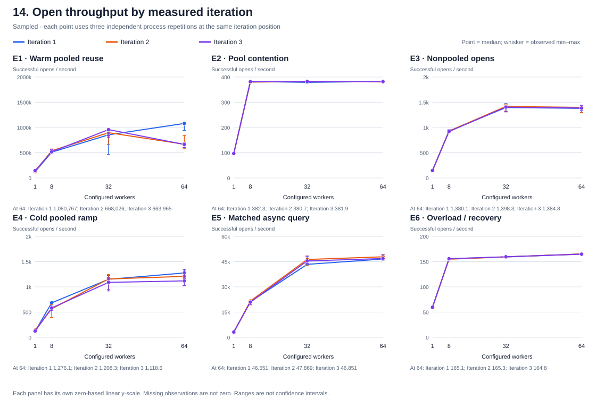

**Interpretation:** each line is a measured iteration position, not a different build. Each point summarizes three independent processes. Warmups were already excluded; later iterations still share JIT/ThreadPool/process history. No best iteration is selected.

| Panel | What to look for |
|---|---|
| E1 | **Short fast-path runs have broad ranges and iteration effects**; do not turn a small difference into a regression verdict. |
| E2 | Capacity is set by four connections and 10 ms holds; iteration positions remain near that limit. |
| E3 | **The high-concurrency plateau appears across positions**, but that does not uniquely attribute it to the client limiter. |
| E4 | Each iteration clears the SQL pool, not the managed ThreadPool or JIT state. Cold SQL pool does not mean cold process. |
| E5 | Query/lifecycle throughput can vary by iteration. Use all predeclared repetitions, not the fastest line. |
| E6 | Throughput is constrained by the prescribed phases, admission and rejection; it is not the overload offered rate. |

## 15. OpenAsync throughput by measured iteration

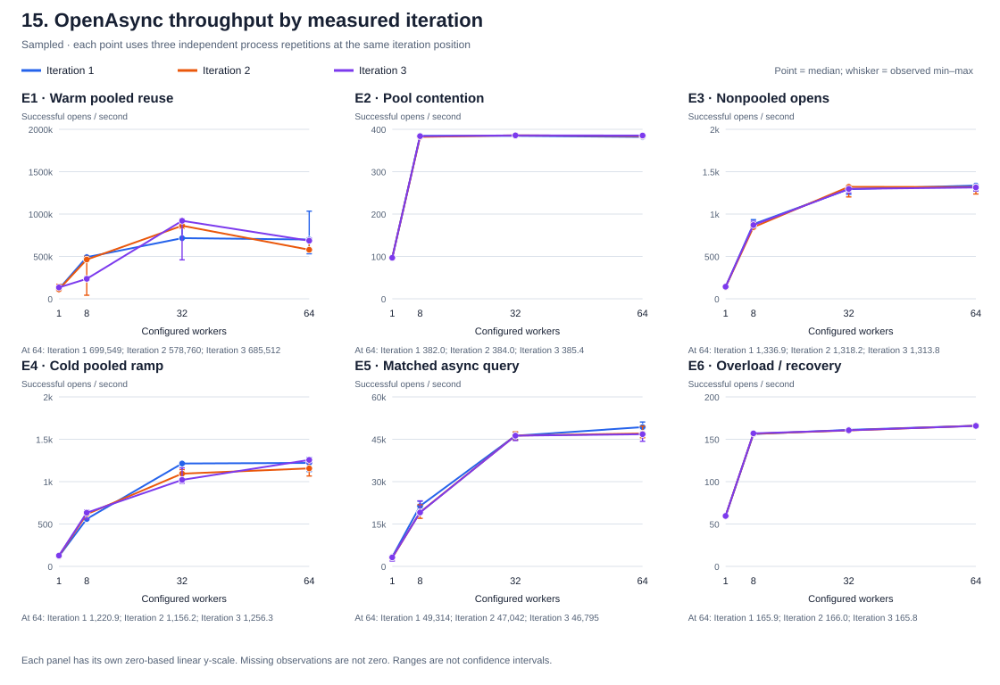

**Interpretation:** each line is a measured iteration position, not a different build. Each point summarizes three independent processes. Warmups were already excluded; later iterations still share JIT/ThreadPool/process history. No best iteration is selected.

| Panel | What to look for |
|---|---|
| E1 | **Short fast-path runs have broad ranges and iteration effects**; do not turn a small difference into a regression verdict. |
| E2 | Capacity is set by four connections and 10 ms holds; iteration positions remain near that limit. |
| E3 | **The high-concurrency plateau appears across positions**, but that does not uniquely attribute it to the client limiter. |
| E4 | Each iteration clears the SQL pool, not the managed ThreadPool or JIT state. Cold SQL pool does not mean cold process. |
| E5 | Query/lifecycle throughput can vary by iteration. Use all predeclared repetitions, not the fastest line. |
| E6 | Throughput is constrained by the prescribed phases, admission and rejection; it is not the overload offered rate. |

## 16. Initial worker admission

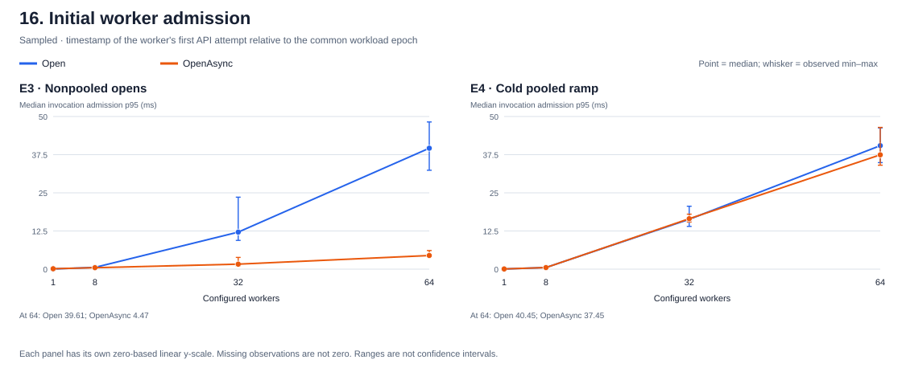

**E3:** at 64 callers, sync admission p95 is **39.61 ms**, async **4.47 ms**. A worker not yet admitted has not entered Open, so that delay is absent from its open-duration timer. It is a once-per-worker measurement, not an extra duration to add to every operation.

**E4:** **both are delayed** (**40.45 / 37.45 ms**). This supports the shared-worker pressure interpretation of cold pooled creation, in contrast to nonpooled LongRunning creation.

## 17. Common-epoch cold completion and matched query

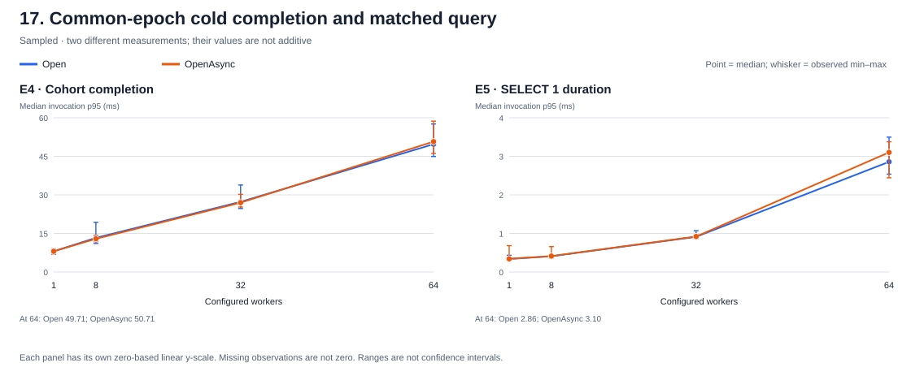

**E4:** at 64 callers, completion measured from the common start is **49.71 / 50.71 ms**, not the approximately 18 ms API-only p95. **The async API returning promptly did not make the full cohort progress promptly.** Do not add admission and open p95s to reconstruct this.

**E5:** the same async query has p95 **2.857 / 3.102 ms** after sync/async opening. Query work is far larger than warm-open time; ranges overlap, and this does not show an end-to-end advantage from the opening API.

## 18. Offered-load admission and rejection

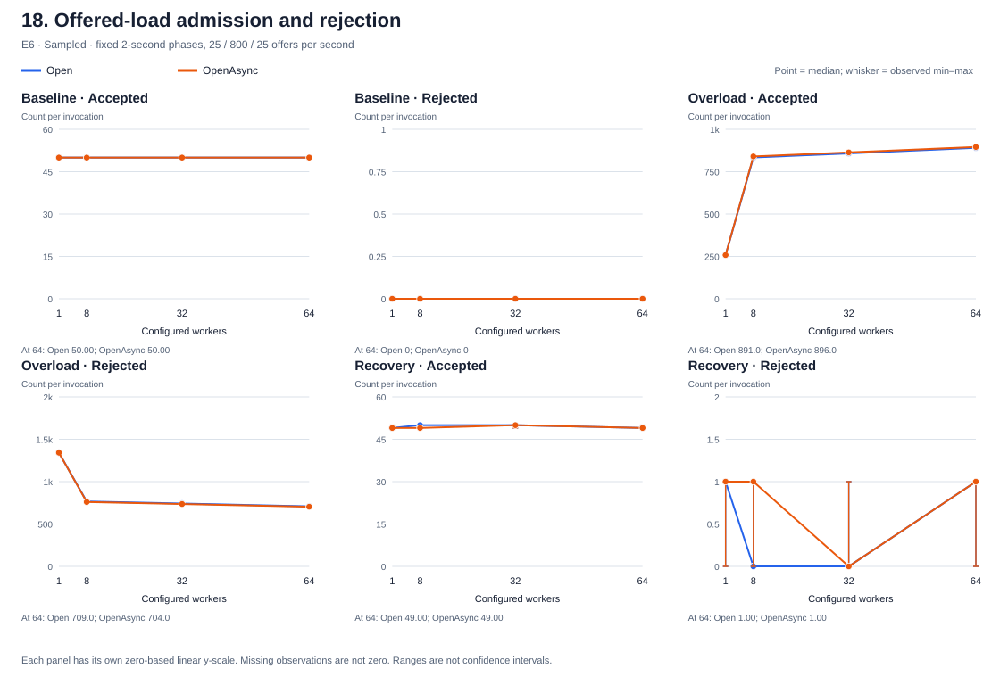

- Baseline: 50 offers at 25/s. Accepted/rejected totals reflect admission into the bounded load channel, not SQL errors.
- Overload: 1,600 offers at 800/s exceed service capacity. Rejections are intentional. More workers allow more in-flight buffering; higher acceptance is not necessarily faster service.
- Recovery: 50 offers at 25/s. **Some invocations reject one early offer while backlog is still full; eventual recovery is not immediate recovery.**

## 19. Phase completions and backlog

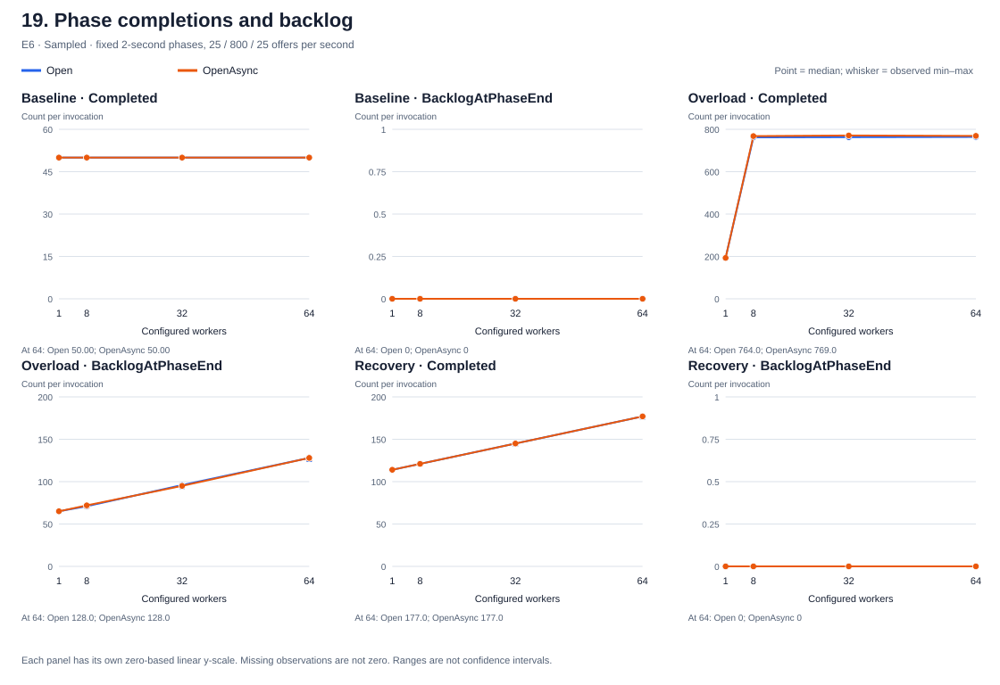

- Completed counts are wall-clock completions inside a phase, regardless of the request's original offer phase.
- The backlog includes accepted work in the queue and active workers. **At 64 workers, overload-end backlog can reach128 even though channel capacity is64.**
- Every Sampled invocation reaches zero backlog by the end of Recovery. Recovery completions can include overload-offered work, so they need not equal50.

## 20. Offered-load latency and final drain

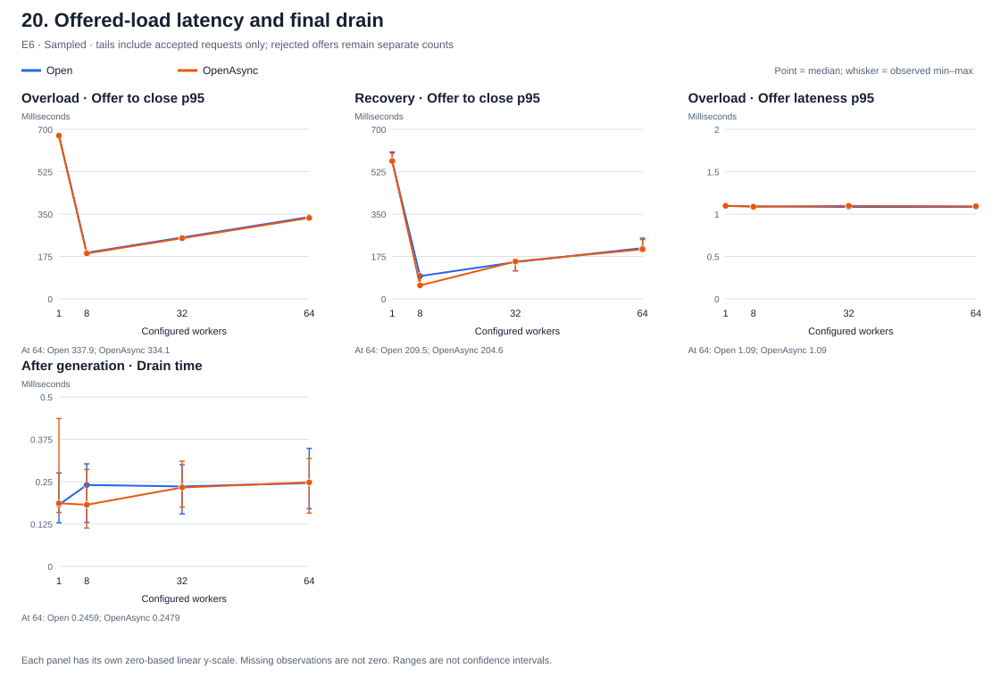

| Panel | Interpretation |
|---|---|
| Overload offer-to-close | Includes scheduled-offer delay, admission, open, hold and close for accepted offers. **At64workers median invocation p95 is337.85ms sync /334.14ms async. More buffering can increase tails.** |
| Recovery offer-to-close | **At64workers p95 remains209.51/204.64ms even though final backlog reaches zero. Early Recovery requests still experience the overload backlog.** |
| Overload offer lateness | About1.1ms p95 here. The independent generator is not perfectly punctual; scheduled versus actual offer times are retained separately. |
| Final drain time | Usually fractions of a millisecond because work already drained during the two-second Recovery phase. This is NOT time-to-recover from overload start/end. |

## 21. Late recovery and final accounting

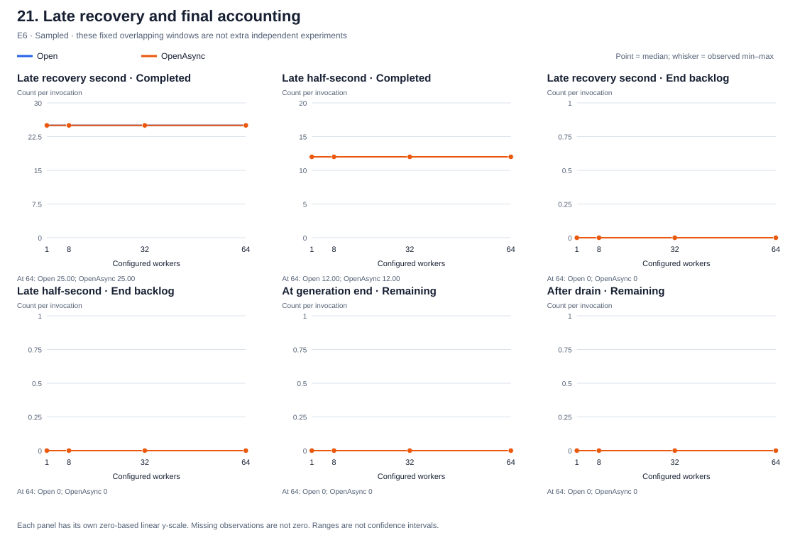

- **Late-window completions:** every Sampled invocation completed25requests in the final second and12in the final half-second. These match the low-rate phase rather than overload throughput.
- **Late-window end backlogs:** both are zero. The windows share the same end boundary, so these are corroborating accounting views—not independent recovery proofs.
- **Remaining at generation end / after drain:** zero accepted requests remain in every Sampled invocation. This does not count deliberately rejected requests as completed.

## Coverage and diagnostic quality — all configurations

The following are counts across nine Diagnostic measured invocations per row. Covered requires at least one contained stack and SQL capture, not continuous coverage. All dropped-probe maxima, reported missed-GC counts and negative-heap counts are zero in these measured observations; that does not make GC polling a complete trace.

| Scenario | API | Workers | Covered /9 | Insufficient /9 | Stack captures | SQL captures | Max dropped probes | Missed GC | Negative heap |
|---|---|---:|---:|---:|---:|---:|---:|---:|---:|
| E1 | Sync | 1 | 0 | 9 | 0 | 0 | 0 | 0 | 0 |
| E1 | Async | 1 | 0 | 9 | 0 | 0 | 0 | 0 | 0 |
| E1 | Sync | 8 | 0 | 9 | 0 | 0 | 0 | 0 | 0 |
| E1 | Async | 8 | 0 | 9 | 0 | 0 | 0 | 0 | 0 |
| E1 | Sync | 32 | 0 | 9 | 0 | 0 | 0 | 0 | 0 |
| E1 | Async | 32 | 0 | 9 | 0 | 0 | 0 | 0 | 0 |
| E1 | Sync | 64 | 0 | 9 | 0 | 0 | 0 | 0 | 0 |
| E1 | Async | 64 | 0 | 9 | 0 | 0 | 0 | 0 | 0 |
| E2 | Sync | 1 | 7 | 2 | 7 | 9 | 0 | 0 | 0 |
| E2 | Async | 1 | 8 | 1 | 8 | 9 | 0 | 0 | 0 |
| E2 | Sync | 8 | 9 | 0 | 9 | 9 | 0 | 0 | 0 |
| E2 | Async | 8 | 9 | 0 | 9 | 9 | 0 | 0 | 0 |
| E2 | Sync | 32 | 9 | 0 | 27 | 32 | 0 | 0 | 0 |
| E2 | Async | 32 | 9 | 0 | 27 | 33 | 0 | 0 | 0 |
| E2 | Sync | 64 | 9 | 0 | 54 | 63 | 0 | 0 | 0 |
| E2 | Async | 64 | 9 | 0 | 54 | 63 | 0 | 0 | 0 |
| E3 | Sync | 1 | 0 | 9 | 0 | 6 | 0 | 0 | 0 |
| E3 | Async | 1 | 0 | 9 | 0 | 9 | 0 | 0 | 0 |
| E3 | Sync | 8 | 0 | 9 | 0 | 9 | 0 | 0 | 0 |
| E3 | Async | 8 | 0 | 9 | 0 | 9 | 0 | 0 | 0 |
| E3 | Sync | 32 | 9 | 0 | 9 | 9 | 0 | 0 | 0 |
| E3 | Async | 32 | 9 | 0 | 9 | 9 | 0 | 0 | 0 |
| E3 | Sync | 64 | 9 | 0 | 18 | 18 | 0 | 0 | 0 |
| E3 | Async | 64 | 9 | 0 | 18 | 18 | 0 | 0 | 0 |
| E4 | Sync | 1 | 0 | 9 | 0 | 0 | 0 | 0 | 0 |
| E4 | Async | 1 | 0 | 9 | 0 | 0 | 0 | 0 | 0 |
| E4 | Sync | 8 | 0 | 9 | 0 | 0 | 0 | 0 | 0 |
| E4 | Async | 8 | 0 | 9 | 0 | 0 | 0 | 0 | 0 |
| E4 | Sync | 32 | 0 | 9 | 0 | 0 | 0 | 0 | 0 |
| E4 | Async | 32 | 0 | 9 | 0 | 0 | 0 | 0 | 0 |
| E4 | Sync | 64 | 0 | 9 | 0 | 0 | 0 | 0 | 0 |
| E4 | Async | 64 | 0 | 9 | 0 | 0 | 0 | 0 | 0 |
| E5 | Sync | 1 | 0 | 9 | 0 | 0 | 0 | 0 | 0 |
| E5 | Async | 1 | 0 | 9 | 0 | 0 | 0 | 0 | 0 |
| E5 | Sync | 8 | 0 | 9 | 0 | 0 | 0 | 0 | 0 |
| E5 | Async | 8 | 0 | 9 | 0 | 0 | 0 | 0 | 0 |
| E5 | Sync | 32 | 0 | 9 | 0 | 0 | 0 | 0 | 0 |
| E5 | Async | 32 | 0 | 9 | 0 | 0 | 0 | 0 | 0 |
| E5 | Sync | 64 | 0 | 9 | 0 | 0 | 0 | 0 | 0 |
| E5 | Async | 64 | 0 | 9 | 0 | 0 | 0 | 0 | 0 |
| E6 | Sync | 1 | 9 | 0 | 36 | 36 | 0 | 0 | 0 |
| E6 | Async | 1 | 9 | 0 | 36 | 36 | 0 | 0 | 0 |
| E6 | Sync | 8 | 9 | 0 | 36 | 36 | 0 | 0 | 0 |
| E6 | Async | 8 | 9 | 0 | 36 | 36 | 0 | 0 | 0 |
| E6 | Sync | 32 | 9 | 0 | 36 | 36 | 0 | 0 | 0 |
| E6 | Async | 32 | 9 | 0 | 36 | 36 | 0 | 0 | 0 |
| E6 | Sync | 64 | 9 | 0 | 36 | 36 | 0 | 0 | 0 |
| E6 | Async | 64 | 9 | 0 | 36 | 36 | 0 | 0 | 0 |

## Complete E6 phase accounting

Each cell is the median of nine per-invocation counts. Offered/accepted/rejected group requests by scheduled offer phase. Started/completed count activity in the actual time window across all offer cohorts; they need not equal that phase's accepted count.

| API | Workers | Phase | Offered | Accepted | Rejected | Started | Completed | End backlog |
|---|---:|---|---:|---:|---:|---:|---:|---:|
| Sync | 1 | Baseline | 50.00 | 50.00 | 0 | 50.00 | 50.00 | 0 |
| Sync | 1 | Overload | 1,600.0 | 258.0 | 1,342.0 | 194.0 | 193.0 | 65.00 |
| Sync | 1 | Recovery | 50.00 | 49.00 | 1.00 | 113.0 | 114.0 | 0 |
| Async | 1 | Baseline | 50.00 | 50.00 | 0 | 50.00 | 50.00 | 0 |
| Async | 1 | Overload | 1,600.0 | 258.0 | 1,342.0 | 194.0 | 193.0 | 65.00 |
| Async | 1 | Recovery | 50.00 | 49.00 | 1.00 | 113.0 | 114.0 | 0 |
| Sync | 8 | Baseline | 50.00 | 50.00 | 0 | 50.00 | 50.00 | 0 |
| Sync | 8 | Overload | 1,600.0 | 834.0 | 766.0 | 770.0 | 762.0 | 71.00 |
| Sync | 8 | Recovery | 50.00 | 50.00 | 0 | 113.0 | 121.0 | 0 |
| Async | 8 | Baseline | 50.00 | 50.00 | 0 | 50.00 | 50.00 | 0 |
| Async | 8 | Overload | 1,600.0 | 840.0 | 760.0 | 776.0 | 768.0 | 72.00 |
| Async | 8 | Recovery | 50.00 | 49.00 | 1.00 | 113.0 | 121.0 | 0 |
| Sync | 32 | Baseline | 50.00 | 50.00 | 0 | 50.00 | 50.00 | 0 |
| Sync | 32 | Overload | 1,600.0 | 858.0 | 742.0 | 795.0 | 763.0 | 96.00 |
| Sync | 32 | Recovery | 50.00 | 50.00 | 0 | 113.0 | 145.0 | 0 |
| Async | 32 | Baseline | 50.00 | 50.00 | 0 | 50.00 | 50.00 | 0 |
| Async | 32 | Overload | 1,600.0 | 864.0 | 736.0 | 803.0 | 771.0 | 95.00 |
| Async | 32 | Recovery | 50.00 | 50.00 | 0 | 113.0 | 145.0 | 0 |
| Sync | 64 | Baseline | 50.00 | 50.00 | 0 | 50.00 | 50.00 | 0 |
| Sync | 64 | Overload | 1,600.0 | 891.0 | 709.0 | 828.0 | 764.0 | 128.0 |
| Sync | 64 | Recovery | 50.00 | 49.00 | 1.00 | 113.0 | 177.0 | 0 |
| Async | 64 | Baseline | 50.00 | 50.00 | 0 | 50.00 | 50.00 | 0 |
| Async | 64 | Overload | 1,600.0 | 896.0 | 704.0 | 833.0 | 769.0 | 128.0 |
| Async | 64 | Recovery | 50.00 | 49.00 | 1.00 | 113.0 | 177.0 | 0 |

## Successful Sampled operation counts

Counts summed across the nine actual invocations. E6 varies with accepted offers; other workloads have fixed work per caller. This table supports completeness checks, not performance ranking.

| Scenario | Workers | Open successes | OpenAsync successes |
|---|---:|---:|---:|
| E1 | 1 | 576 | 576 |
| E1 | 8 | 4,608 | 4,608 |
| E1 | 32 | 18,432 | 18,432 |
| E1 | 64 | 36,864 | 36,864 |
| E2 | 1 | 576 | 576 |
| E2 | 8 | 4,608 | 4,608 |
| E2 | 32 | 18,432 | 18,432 |
| E2 | 64 | 36,864 | 36,864 |
| E3 | 1 | 576 | 576 |
| E3 | 8 | 4,608 | 4,608 |
| E3 | 32 | 18,432 | 18,432 |
| E3 | 64 | 36,864 | 36,864 |
| E4 | 1 | 9 | 9 |
| E4 | 8 | 72 | 72 |
| E4 | 32 | 288 | 288 |
| E4 | 64 | 576 | 576 |
| E5 | 1 | 576 | 576 |
| E5 | 8 | 4,608 | 4,608 |
| E5 | 32 | 18,432 | 18,432 |
| E5 | 64 | 36,864 | 36,864 |
| E6 | 1 | 3,212 | 3,214 |
| E6 | 8 | 8,396 | 8,457 |
| E6 | 32 | 8,621 | 8,677 |
| E6 | 64 | 8,911 | 8,960 |

## Interpretation and limits

- **The nonpooled limiter is real:** source uses16creation chains in this runtime. Outstanding calls include waiting requests. Throughput flattening and increasing open latency fit queueing, but the fraction caused by that cap versus server/CPU/network effects is unmeasured.
- **Sync queues elsewhere:** initial caller admission delay is outside the Open-duration timer. A lower sync open p95 does not prove lower scheduled-to-completion latency. Never add p95s.
- **Cold pooled creation differs:** source dispatches synchronous physical creation onto ordinary ThreadPool workers; nonpooled async uses LongRunning tasks. E4 has no contained stack captures, so exact runtime attribution of its delays remains unproven.
- **No version-comparison conclusion:** all data here are current-source V2. The older controls used different source/runtime/pool settings; the historical7.0.2comparison is still blocked.
- **Evidence coverage:** all96configurations and864actual invocations are accounted for;576warmups are excluded. Across both modes,1,088,667opens and241,920queries succeeded without recorded open/query/lifecycle failures or cancellations. Sparse probes and external captures remain limitations.
- **What is not graphed:** raw per-operation timelines, per-wait-type SQL details, full GC events, and active creation-lane occupancy are not in the recovered analysis. No missing metric is reconstructed.

## Provenance and related views

- Recovered analysis SHA-256: `73ea135abd463529f21296fd4d856e694c56906b08f18d68db97d4ff5712f0c8`.
- `v2-all-graphs/plotted-values.json` retains every plotted coordinate's source aggregate and count.
- [Narrative scorecard](openasync-v2-results-183246.md).
- [Earlier focused graphs](openasync-v2-graphs.md).
- This atlas uses retained observations only. No benchmarks, publications, raw-data edits, dependency changes or infrastructure changes were performed.
