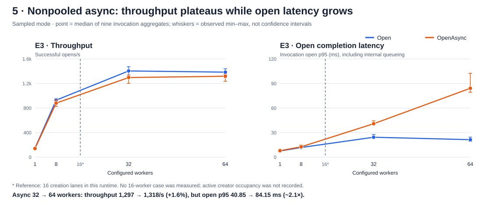
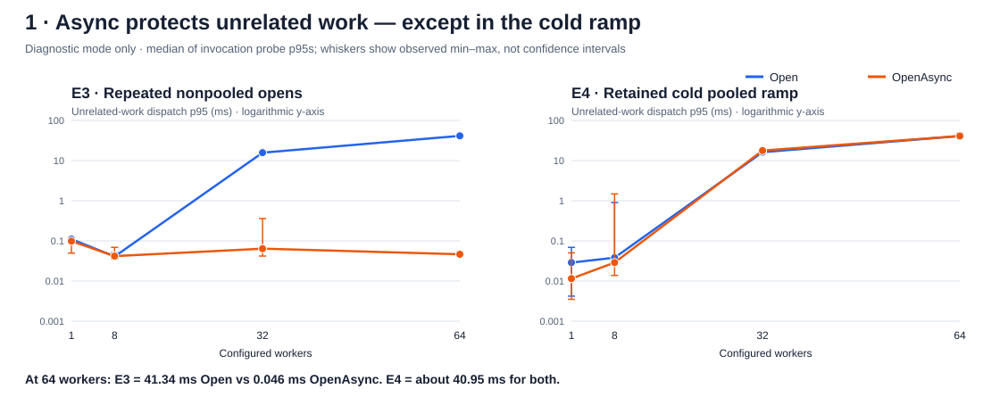
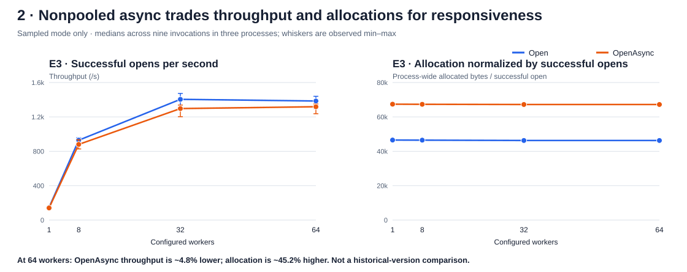
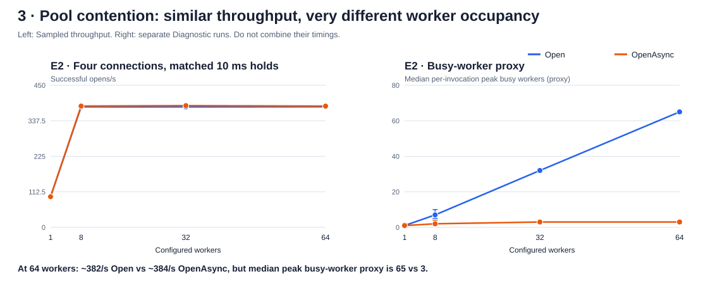
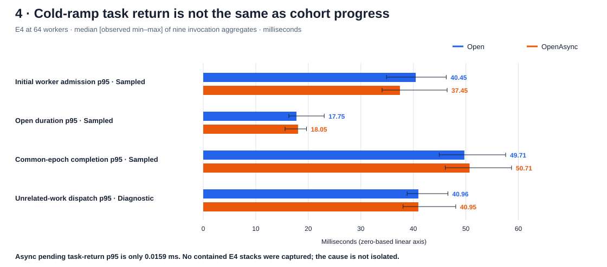

# OpenAsync results — the interesting graphs

**Run 183246 · current-source V2 pooling · Ubuntu 22.04 / .NET 10.0.13**

Blue is **Open**; orange is **OpenAsync**. Points/bars are medians of nine per-invocation
aggregates from **three independent processes**, excluding warmups. Whiskers show
the observed minimum and maximum, **not confidence intervals**. A median of invocation
p95s is not a pooled-operation p95. Points with fewer than nine usable probe observations
are labeled with their available count; missing observations are not zero.

## The missing view: the nonpooled creation limit

**Yes, limiting creation slows the OpenAsync requests themselves once they queue.**
At 32 to 64 callers, median throughput barely changes (**1,297 to 1,318/s**), while
the median invocation open p95 grows from **40.85 to 84.15 ms**.

| Configured callers | OpenAsync /s | OpenAsync open p95 ms | Open open p95 ms | Async median peak outstanding |
|---:|---:|---:|---:|---:|
| 1 | 140.7 | 7.92 | 7.55 | 1 |
| 8 | 880.2 | 12.64 | 11.81 | 8 |
| 32 | 1,297.0 | 40.85 | 24.33 | 32 |
| 64 | 1,318.2 | 84.15 | 21.34 | 64 |

The source has **16 task chains** (`Environment.ProcessorCount` for this run).
Each chain serializes synchronous physical creation on `LongRunning` tasks.
**64 outstanding OpenAsync calls do not mean 64 active physical connection creations**:
outstanding includes requests queued behind those chains and awaiting completion.
The benchmark's open timer surrounds the whole API call/await, so this internal wait
is included in open latency. It does not measure creation-lane occupancy separately.

The earlier graphs emphasized unrelated-work latency. Both statements can be true:
**OpenAsync callers wait longer, while unrelated ThreadPool work stays responsive.**
Blocking creation is isolated from ordinary ThreadPool workers; it is not eliminated.

The sync comparison queues elsewhere: at 64 configured workers, its median peak
outstanding opens is only **23**, and initial admission p95 is **39.61 ms** versus
**4.47 ms** for async. Work waiting to enter `Open` is not included in that call's
open-duration timer. Therefore the 21.34 vs 84.15 ms comparison is not proof that
the complete async workload takes four times as long. Do not add admission and open p95s.

**Attribution limit:** source confirms the creation cap; the measured plateau and
growing latency are consistent with queueing. SQL/network/CPU limits can also contribute.
There is no measurement at 16 workers and no creator-occupancy trace, so the dashed
line is a source-derived reference—not a measured knee or a causal decomposition.

## 1. Most revealing: nonpooled responsiveness vs cold ramp

**Why it matters:** E3 shows the benefit that throughput alone misses. At 64 workers,
unrelated-work p95 is **41.34 ms with Open versus 0.046 ms with OpenAsync**. E4 is the
important exception: both reach roughly **41 ms**. These plots use a clearly labeled
**logarithmic y-axis**, so each equal vertical step represents a tenfold change.

The observations come from separate **Diagnostic** runs. They suggest where scheduling
needs investigation; they do not establish an implementation-level cause.

## 2. The tradeoff: async is not automatically faster or cheaper

**Why it matters:** at 64 workers, async improves unrelated-work responsiveness while
its median throughput is **4.8% lower** and normalized allocation is **45.2% higher**.
Both effects need to be visible when assessing “good async.” Allocations are process-wide
and include instrumentation, not isolated per-operation allocation attribution.

## 3. The useful control: pool contention

**Why it matters:** both APIs hit the same four-connection / 10 ms hold bottleneck.
Async cannot make that capacity limit disappear, but needs far fewer occupied workers
while waiting. The busy-worker metric is an availability-based proxy, not a blocked-thread
count. At 64 workers, contained stack captures separately observed up to **61 blocking-open
threads for sync and zero for async**; sparse observations are not proof of no blocking.

Unrelated-work p95 was about **0.12 ms for both** in E2. Reduced worker occupancy does not
necessarily produce a responsiveness gain in every workload.

## 4. Highest-priority investigation: cold pooled ramp

**Why it matters:** async returns a pending task in microseconds, yet later workers and
unrelated work still wait tens of milliseconds. Measure task return, worker admission and
common-epoch completion separately; they are not interchangeable.

**Do not add these p95 values together.** They describe different distributions and,
for the unrelated-work row, a different instrumentation mode. There were no contained
external E4 captures, so this is an observed problem area—not a diagnosed driver bug.

## What is less surprising

- **E1 warm reuse:** all measured async opens completed at return; this tests the fast
  synchronous-completion path, not pending async behavior. Short-run throughput varied widely.
- **E5 matched query:** the same async query dominates the workload; throughput is similar
  regardless of the opening API.
- **E6 overload/recovery:** both reject excess offers and drain accepted work by recovery's
  end. Async does not remove queueing or make recovery immediate.

## Scope and provenance

These are **not baseline-versus-current graphs**. Every line comes from current source
`abff493d9`, V2 pooling enabled. Diagnostic timings are not substituted for Sampled timings.
Only **177 of 432** Diagnostic measured invocations had contained stack and SQL observations.
The complete recovered scorecard includes coverage and variability details:
[OpenAsync V2 results](openasync-v2-results-183246.md).

Graphs use only the recovered, hash-verified compact analysis and small latency-context
report. No new benchmarks, publication changes or raw-data modifications were performed.
